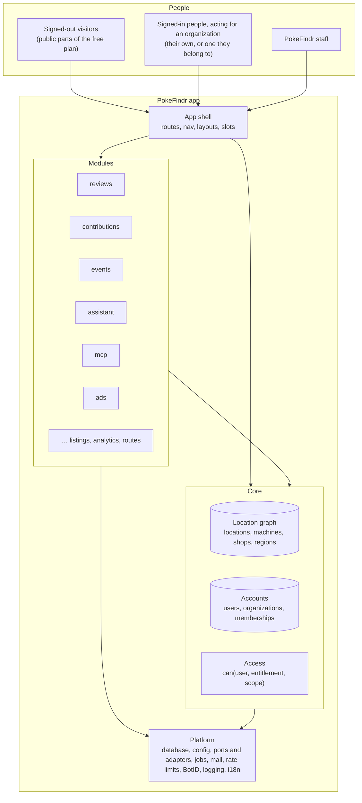
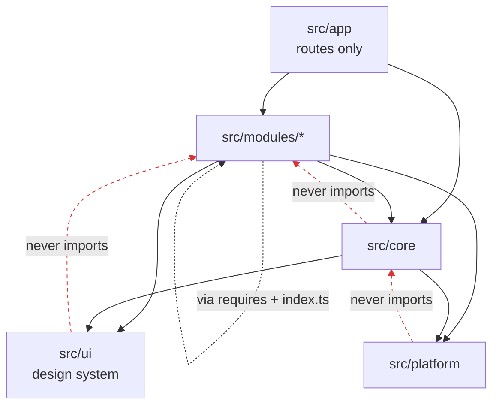
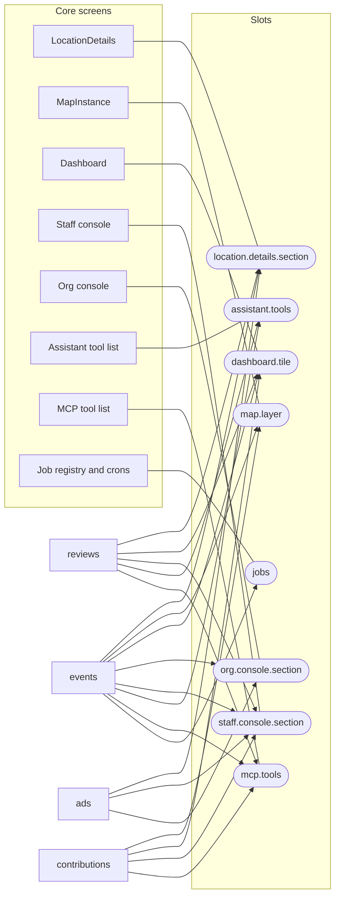
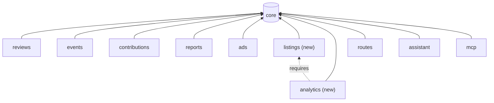
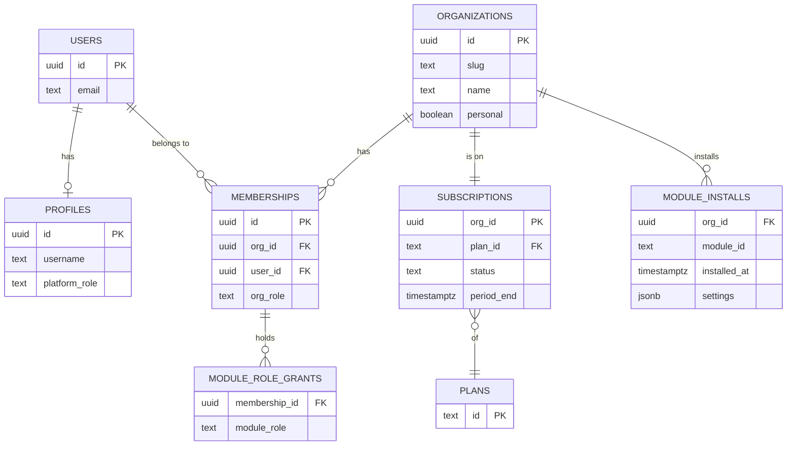
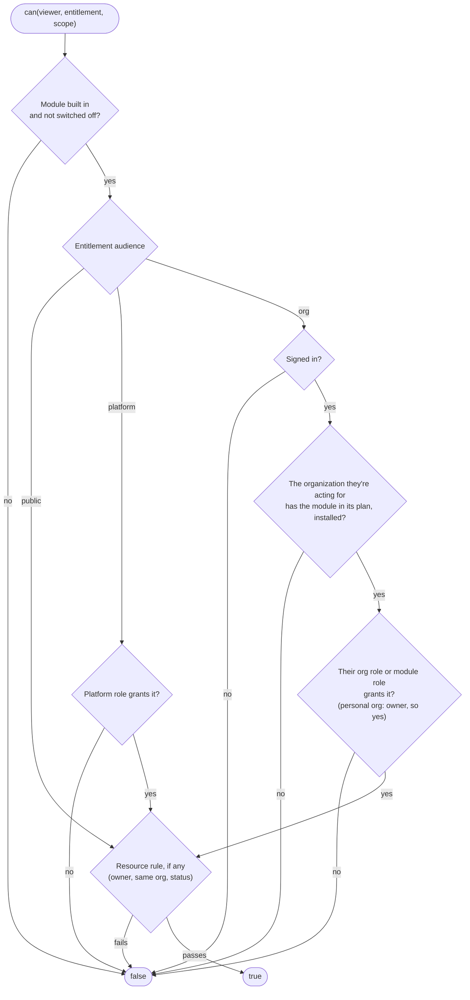
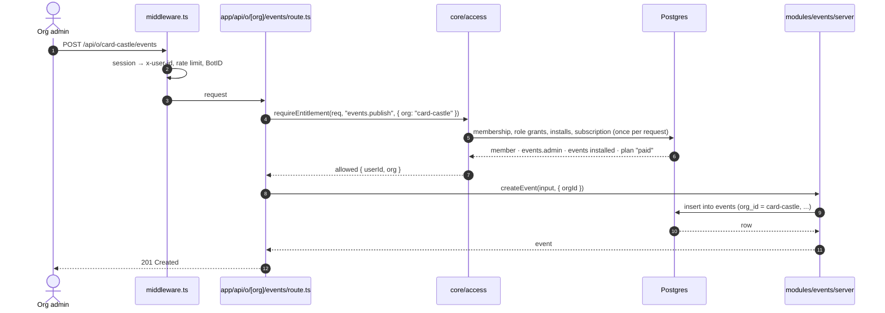
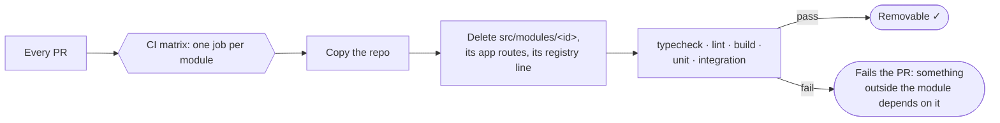
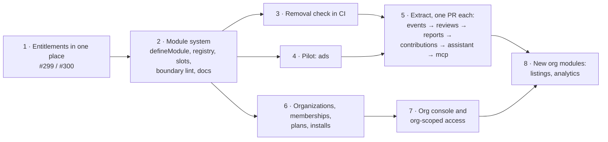

# Architecture: core, modules and organizations

**Status: proposed.** This describes where PokeFindr's structure is going, not how the code works
today. The [migration path](#migration-path) says how we get from one to the other. Decisions
still open are marked **(open)** and collected at the end.

PokeFindr is moving to the model Rippling uses. One shared core holds the data every feature
needs, and features are **modules**. An **organization** can be anyone: a person, a shop, a
company. It gets entitlements to specific modules through the **plan** it's on, starting with a
simple `free` and `paid`. Each
module brings its own permissions, screens, API, jobs and tools, and plugs into the core through
named extension points. Two goals follow from that:

1. **Mix and match.** A plan is a bundle of modules. A new plan, or a custom deal, is a new
   bundle, with no other code change.
2. **Remove without side effects.** Deleting a module's folder and its line in the registry
   leaves the rest of the app building, passing its tests and working. CI proves this for every
   module, on every PR.

## Contents

- [The model at a glance](#the-model-at-a-glance)
- [Words we use](#words-we-use)
- [Layers and dependency rules](#layers-and-dependency-rules)
- [Code layout](#code-layout)
- [Modules](#modules)
- [Organizations, plans and installs](#organizations-plans-and-installs)
- [Access checks](#access-checks)
- [Data ownership and tenant isolation](#data-ownership-and-tenant-isolation)
- [Removing a module](#removing-a-module)
- [Module catalog](#module-catalog)
- [Migration path](#migration-path)
- [Open questions](#open-questions)

## The model at a glance



- **The core** is what every module needs and no plan can remove: the location graph,
  accounts and organizations, and the access check.
- **Modules** are features. An organization's plan says which ones it gets, and the public free
  experience is itself a set of modules.
- **The shell** owns the pages' frame (nav, layouts, the admin consoles) and fills it from
  modules through **slots**.
- **The platform** is infrastructure with no product logic. It's mostly the `server/ports` and
  `server/adapters` we already have.

## Words we use

| Word | Meaning |
| --- | --- |
| **Core** | Code and data every module may depend on. It never imports a module. |
| **Module** | A feature with one manifest (`module.ts`) declaring its id, dependencies, entitlements, roles and contributions. |
| **Registry** | `src/modules/registry.ts`, the only list of the modules that are built into the app. |
| **Organization** | Whoever holds a plan. It has no type: a person (every account gets a personal organization), a shop, a company, anyone. It has members, a plan and installed modules. |
| **Plan** | What we sell: a named bundle of modules, whose entitlements the organization gets. To start, `free` and `paid`. |
| **Install** | A module turned on for one organization. The plan sets what can be installed; an organization admin installs it. |
| **Entitlement** | One thing someone may do, owned by a module, e.g. `events.publish`. |
| **Module role** | A bundle of one module's entitlements, assigned to a member within an organization, e.g. `events.editor`. |
| **Platform role** | PokeFindr staff roles (`moderator`, `admin`, `super_admin`), for running the service itself, not a customer. |
| **Slot** | A named extension point that core renders and modules fill, e.g. `location.details.section`. |
| **Personal organization** | The one-member organization every account gets at sign-up, on the `free` plan. It's how an individual has a plan without a separate kind of customer. |
| **Scope** | What a check is about: the public site, one organization, or one record. |

## Layers and dependency rules



1. **`app` → `modules`/`core` → `platform`/`ui`.** Dependencies only point that way.
2. **Core never imports a module.** This is what makes removal safe. Core reaches modules only
   through the registry and slots.
3. **A module imports another module only if it declares it in `requires`, and only through
   that module's `index.ts`.** No deep imports, and no import cycles.
4. **`platform` and `ui` know nothing about the product.**
5. **Lint enforces all of this** (`eslint-plugin-boundaries`, or `dependency-cruiser`), and CI
   fails on a violation. #300's guard test against role-name checks is the same idea at a smaller
   scale.

## Code layout

```text
src/
  app/                         # Next.js routes. Thin files that call into core or a module.
    [locale]/(public)/...       #   public pages
    [locale]/(org)/[org]/...    #   an organization's console: /o/<org>/...
    [locale]/(staff)/admin/...  #   PokeFindr staff console (today's /admin)
    api/...                     #   route handlers, each guarded by requireEntitlement
  core/
    locations/                 # the location graph: locations, machines, shops, regions, search
    accounts/                  # users, profiles, organizations, memberships, sessions
    access/                    # can(), requireEntitlement, entitlement table built from modules
    shell/                     # <Slot>, nav and layout composition, the registry loader
  modules/
    registry.ts                # the only list of built-in modules
    plans.ts                   # plan → modules
    reviews/
      module.ts                # the manifest
      index.ts                 # public API for modules that `require` this one
      server/                  # services, queries ("server-only")
      ui/                      # components that fill slots
      shared/                  # types, zod schemas, constants (client-safe)
      db/schema.ts             # this module's tables
      messages/                # en.yml, es.yml for the `reviews` namespace
    events/ ...
  platform/                    # db client, config, container, ports, adapters, jobs, mail,
                               # rate limits, BotID, logging, i18n runtime
  ui/                          # design system (today's components/ui + components/pokefindr)
database/migrations/           # one ordered folder for core and modules, see "Data ownership"
```

Next.js requires every route to live in `src/app`, so a module's pages and API routes are thin
files there, grouped under the module's id. They are part of what's deleted when the module is
removed.

## Modules

### The manifest

Each module declares everything about itself in one file. Core reads manifests only through the
registry.

```ts
// src/modules/events/module.ts
import { defineModule } from "@/core/shell/module"

export default defineModule({
  id: "events",
  name: "Events",
  requires: [],                         // other modules this one needs, if any

  entitlements: {
    "events.view":     { audience: "public" },              // anyone, signed in or not
    "events.submit":   { audience: "org" },                 // anyone signed in whose plan includes events
    "events.manage":   { audience: "org" },                 // within an organization that installed events
    "events.publish":  { audience: "org" },
    "events.moderate": { audience: "platform", roles: ["moderator", "admin"] },
  },

  roles: {                              // module roles an organization admin can assign
    "events.admin":  ["events.manage", "events.publish"],
    "events.editor": ["events.manage"],
  },

  contributes: {
    "location.details.section": () => import("./ui/LocationEvents"),
    "map.layer":                () => import("./ui/EventMarkers"),
    "dashboard.tile":           () => import("./ui/UpcomingEventsTile"),
    "org.console.section":      { id: "events", entitlement: "events.manage", load: () => import("./ui/OrgEvents") },
    "staff.console.section":    { id: "events", entitlement: "events.moderate", load: () => import("./ui/EventQueue") },
    "assistant.tools":          () => import("./server/assistant-tools"),
    "mcp.tools":                () => import("./server/mcp-tools"),
    "jobs":                     { "expire-events": () => import("./server/expire-events") },
    "sitemap":                  () => import("./server/sitemap"),
  },
})
```

### Slots

Core defines each slot's name and what it receives. Modules fill them. Core renders whatever the
installed modules contribute, in a stable order, and renders nothing when none do.



```tsx
// core: LocationDetails renders whatever installed modules contribute
<Slot name="location.details.section" props={{ location, viewer }} />
```

- **Typed:** each slot's props live in `src/core/shell/slots.ts`. Changing a slot's contract is a
  core change, reviewed as one.
- **Gated:** a contribution can name an entitlement. `<Slot>` leaves it out when the viewer's
  `can()` is false, so modules don't each repeat the check.
- **Lazy:** contributions are dynamic imports, so a page only loads the modules it shows.
- **Server-side lists** use the same idea: the assistant's tools, MCP tools, jobs and sitemap
  entries are collected from the registry, filtered by what the caller may use.

The slots we need first come straight from today's hard-wired screens: `LocationDetails`,
`MapInstance`, `Dashboard`/`DashboardTiles`, `AdminApp`, the assistant's `tools.ts`, MCP's
`account-tools.ts`, the job registry, `middleware.ts` path lists, the sitemap, and the settings
page sections.

### Dependencies between modules



Most modules depend only on core. A module that needs another declares it in `requires`, and the
registry refuses to start if a required module is missing. A plan that includes a module includes
everything it requires.

A module that merely *works better* with another, such as the assistant summarizing reviews when
`reviews` is installed, must not require it. It uses a slot instead: `reviews` contributes a
`get_reviews` assistant tool, and without `reviews` the tool simply isn't offered.

## Organizations, plans and installs



- **Organizations have no type.** Nothing in core knows whether an organization is a person, a
  shop or a brand. What it can do comes only from the modules its plan includes, so selling to a
  new kind of customer is a new plan, not new code.
- **Every account gets a personal organization** on the `free` plan when it signs up, with the
  account as its owner. It's what a person acts as by default. They can also join or create other
  organizations and switch between them in the shell.
- **Plans are code, not rows.** `src/modules/plans.ts` maps each plan to its modules, reviewed in
  PRs. `PLANS` in the database only holds the ids, so subscriptions can reference them. A custom
  deal is a new plan entry.
- **The plan sets what an organization *may* install, and installs say what it *has*.** That
  lets an organization keep a module off without changing plan, and lets us switch a module off
  for everyone (a kill switch in config or Edge Config) without touching plans.
  An organization starts with every module in its plan installed, and gains new ones when it
  changes plan, so a personal organization never has to install anything.
- **Org roles are `owner`, `admin` and `member`.** Owners and admins manage members, installs and
  billing. Module roles are granted per member on top of that.
- **Platform roles stay on `profiles`.** That's today's `profiles.role`, renamed `platform_role`
  once organizations exist. They're for PokeFindr staff and never come from a customer's plan.
- **Links between an organization and locations belong to modules,** not core. For example,
  `listings` would own a `listing_claims` table (org, location, status) for an organization that
  manages a place's listing. The location itself stays in core and stays public.
- **Signed-out visitors** have no organization. They get only the entitlements whose audience is
  `public` (browsing the map, reading reviews and events, seeing sponsored cards).

```ts
// src/modules/plans.ts (illustrative)
// Everything the public can do today stays free.
const FREE = ["reviews", "events", "contributions", "reports", "assistant", "routes", "mcp", "ads"] as const

export const PLANS = {
  free: FREE,                                  // every personal organization starts here
  paid: [...FREE, "listings", "analytics"],    // adds the organization modules
} as const satisfies Record<string, readonly ModuleId[]>

// Later: more plans are new bundles, e.g. a business tier, or a custom deal for one customer.
```

## Access checks

One function answers every question. It extends #300's `can(role, entitlement)` to take the
person and a scope.

```ts
can(viewer, "events.publish", { org })              // may this person publish events for this org?
can(viewer, "reviews.edit",   { resource: review }) // may they edit this review?
await requireEntitlement(request, "events.manage", { org: params.org }) // API routes: 401 / 404
```



- **Resource rules** live in the module, next to its entitlements. For example:

  ```ts
  "reviews.edit": { audience: "org", resource: (viewer, review) => review.userId === viewer.id }
  ```

  This is the `ability.rb`/CASL idea: rules about one record live in the same table as the
  permission.
- **Fails closed.** An entitlement no rule grants is false. A module that isn't built in has no
  entitlements at all.
- **Lists, not only yes/no.** For queries, modules also export a scope filter (e.g. "events this
  viewer may manage"), so lists and single-record checks agree.
- **Cached per request.** The viewer's memberships, installs and grants are loaded once per
  request (React `cache()` on the server). A change applies on the next request, as roles do
  today.

### A request, end to end



## Data ownership and tenant isolation

- **Each module owns its tables** in `src/modules/<id>/db/schema.ts`. The Drizzle schema entry
  point re-exports the core's and every built-in module's, so `db:check` still compares one
  schema.
- **References point inward.** Module tables may reference core tables (`locations`, `users`,
  `organizations`). Core tables never reference a module's tables. Modules reference each other
  only along a declared `requires`.
- **Every organization-owned row has an `org_id`.** Queries for organization data go through a
  scoped helper (`orgScoped(db, orgId)`) that adds the filter, so no query can forget it. Postgres
  row-level security on those tables is the backstop, so a bug in one query still can't read
  another organization's rows. **(open: whether to turn RLS on from the start.)**
- **Migrations stay in one ordered folder** (`database/migrations`). A module's migrations are
  prefixed with its id in the description (`0031_events_org_id.ts`). Removing a module leaves
  its tables in the database, unused and harmless. A separate, deliberate migration drops them
  later.
- **Downgrades keep data.** If an organization loses a module, its data stays and becomes
  unreachable until the module is back. Nothing is deleted automatically.
- **Public content stays public.** Plans gate what someone can *do*, not what the public can
  *read*: reviews, events and locations shown on the map don't disappear for viewers on a
  smaller plan. **(open)**

## Removing a module



To remove a module for real:

1. Delete `src/modules/<id>/` and its route files under `src/app` (grouped by module id).
2. Delete its line in `src/modules/registry.ts`, and take it out of `plans.ts`.
3. Leave its migrations and tables. Drop them later in a separate migration, after a backup.

Nothing else should need to change. If something does, the CI matrix above would already have
failed. `scripts/modules/without.ts <id>` runs the same check locally.

## Module catalog

How today's features would split. **Plan** is where the module starts out in the example plans:
`free` (everyone, including each personal organization) or `paid`.

| Module | Today | Plan | Contributes | Notes |
| --- | --- | --- | --- | --- |
| **core: locations** | `services/locations.ts`, `lib/locations`, map data, search, region counts, coverage, vending, canaries | always | — | Not removable. The scraping protections (`docs/scraping.md`) stay here. |
| **core: accounts** | `server/auth`, `services/users.ts`, settings, entitlements (#300) | always | — | Adds organizations and memberships. |
| `reviews` | `services/reviews.ts`, `components/map/Reviews.tsx`, `/api/reviews*` | free | details section, dashboard tile, staff queue (#253), assistant and MCP tools | |
| `contributions` | add a place, `services/submissions.ts`, `services/moderation.ts`, review queue | free | map action, dashboard tile, staff queue, MCP tools | |
| `reports` | `services/reports.ts`, `report-admin.ts`, Reports table | free | details action, staff section | |
| `events` | `services/highlights.ts`, `expire-events`, event markers | free | map layer, details section, tile, org and staff consoles, job | Anyone whose plan includes it can publish events from their org console. |
| `assistant` | `server/assistant/*`, `components/assistant/*`, `/api/assistant*` | free | home, map routes, settings section | Collects tools from other modules. |
| `routes` | assistant route cards, `RouteOverlay.tsx` (#288) | free | map layer, assistant tool | Requires `assistant`. |
| `mcp` | `server/mcp/*`, `/api/mcp*`, OAuth consent | free | developers page, settings | Collects tools from other modules. |
| `ads` | `SponsoredPlacement`, `ad-placements.ts`, Ads switches | free | slots in results, details and landing; org console | Serves sponsored cards to the public. A plan can grant `ads.hidden` to turn them off for its members. |
| `listings` **(new)** | — | paid | org console, details badge | Claim and manage a place's listing. Owns the link between an organization and locations. |
| `analytics` **(new)** | — | paid | org console | Views and reach for an organization's locations. Requires `listings`. |

## Migration path



1. **Entitlements in one place** (#299, PR #300). Every access check already goes through
   `can()`/`requireEntitlement()`. This step is in progress.
2. **The module system.** `defineModule`, the registry, `<Slot>` and server-side slot lists, the
   entitlement table built from manifests, the boundary lint rule (warnings first).
3. **The removal check in CI**, starting with modules that have been extracted.
4. **Pilot: `ads`.** It's small and self-contained, and it tests a plan *removing* something
   (`ads.hidden`).
5. **Extract the rest, one PR each, with no behavior change.** Move the code with `git mv`,
   declare the entitlements, and replace the hard-wired references with slot contributions.
   Order: smallest and least depended-on first. R11 work that adds features (#253's held reviews,
   #288's routes, #290's avatars) should be built as module code from the start where possible.
6. **Organizations.** Tables, memberships, plans, installs, and the organization switcher.
7. **Org console and org-scoped checks.** `/o/<org>/…`, members and module roles, installs, and
   `can(viewer, e, { org })`.
8. **New organization modules**, starting with `listings`.

Each step leaves `main` working, and the lint rule switches from warnings to errors once step 5
is done.

## Open questions

1. **Who are the organizations?** *Decided:* anyone. Organizations have no type, and what they
   can do comes only from the modules in the plan they buy. Plans start as `free` and `paid`.
   Every account gets a personal organization on `free`.
2. **Can a person belong to several organizations?** Assumed: yes. Their personal organization,
   plus any they create or are invited to, with a switcher in the shell. Rippling assumes one
   company per employee.
3. **What goes in `free` and `paid`?** The example in "Organizations, plans and installs" is a
   starting point. Assumed: everything the public can do today stays in `free`.
4. **Do plans gate reading, or only doing?** Assumed: only doing. Public content stays visible
   whatever the plan.
5. **Row-level security from the start?** Recommendation: yes for organization-owned tables, as
   the backstop behind `orgScoped()`.
6. **Billing.** Out of scope here. Plans can be set by staff by hand (#294's user management)
   until a billing provider is chosen.

## Not in scope

- **Separate deployments or a micro-frontend split.** Modules are folders in one Next.js app and
  one database. Splitting them into packages or services can come later if a module needs its own
  team or scaling, and the boundaries above make that possible.
- **Third-party modules or a marketplace.** The registry is ours. Partners integrate through the
  MCP server and the API.
